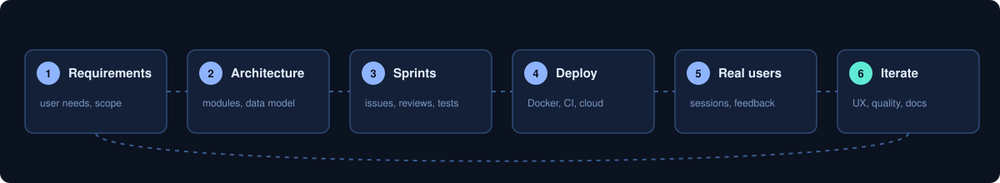

  

<h1 align="center">Hi, I'm Franks 👋</h1>

  <strong>Backend Development · Software Engineering · Software Architecture</strong>

  
  
  

I am a Master's student in Computer Science (Software Techniques track) at the **University of Bologna**, with a bachelor's degree in Computer Science for Management. I build backend systems and web platforms, from the data model to deployment, and I am growing towards **software architecture**: modular design, maintainability and decisions I can explain.

## 🧩 What I build

  

- **Web platforms in production:** booking and content-management apps, deployed and used by real people.
- **Backend and data:** layered APIs, relational database design, query optimisation and schema evolution.
- **Event-driven components:** services that react to on-chain events and expose results through REST APIs.

## 🚀 Featured work

### [Griot – booking platform for small service providers](./projects/griot.md)

A web app where hairdressers, braiders, beauticians and food vendors publish a showcase page and receive bookings. Deployed on **Render**, images on **S3 object storage**, email notifications, installable as a **PWA**, with booking export to Google and Apple Calendar. Designed and run by me with AI-assisted development (Claude Code); I own the requirements, architecture, code review and testing sessions with real providers.

→ [Project overview](./projects/griot.md) · [Live app](https://griot-axbs.onrender.com/) · [Repository](https://github.com/franksToscani/griot)

### [Semantic Indexer for the Web of Things (ZONIA)](./projects/zonia-indexer.md)

Bachelor's thesis: an end-to-end prototype that listens to **on-chain events**, selects compatible **Thing Descriptions** through semantic matching and serves the results to oracles via a **REST API**. Two-level access (in-memory cache with database fallback) and benchmarks on 10,000 synthetic TDs at 1, 10 and 30 requests per minute.

→ [Project overview](./projects/zonia-indexer.md) · [Repository](https://github.com/franksToscani/Indexer_ZONIA_node-WoT)

### [AS.CA.I Bologna – association website](https://github.com/franksToscani/ascai_blog)

Public website (news, events, gallery, contact form) with an admin panel, audit log, full SEO and GitHub CI. The first version used Vue/Inertia; I migrated it to Blade + Alpine.js for SEO and maintainability, and moved the database from Postgres to SQLite on a persistent disk.

→ [Repository](https://github.com/franksToscani/ascai_blog) · [Live site](https://ascai-bo.it/)

## 🛠️ Tools I use

  
  
  
  
  
  
  
  
  
  
  
  

  
<strong>University projects</strong>

   

- **[Nota Bene](https://github.com/franksToscani/nota-bene):** shared-notes web app with versioning and read/write permissions. Layered Spring Boot backend, PostgreSQL, Docker Compose and JUnit tests; Scrum in a team of 3 with rotating roles.
- **[Inventory Manager](https://github.com/franksToscani/InventoryManager):** native Android app (Java, MVVM, Room) with barcode scanning, CSV export and charts, built over 6 sprints.
- **Multiplayer Tetris:** object-oriented game in Java with a JavaFX interface.

  
<strong>Experience</strong>

   

- **Softweb** – Backend Developer intern (Nov 2025 – Jan 2026): Laravel/MySQL admin panel in MVC, ER modelling and migrations, Inertia.js + Vue 3 SPA, role-based access control.
- **SIR Case S.r.l.** – Backend Developer (2022): query and schema optimisation for the in-house management system, backend monitoring and maintenance.

## 🤝 Let's connect

I am interested in **backend engineering**, **software architecture** and building products with real users. Feel free to reach out.

  <a href="https://linkedin.com/in/koudja-franks-toscani-22b44b26b">LinkedIn</a> ·
  <a href="mailto:ftoscani111@gmail.com">Email</a> ·
  <a href="https://griot-axbs.onrender.com/">Griot</a> ·
  <a href="https://ascai-bo.it/">AS.CA.I Bologna</a>

🇮🇹 Italiano · 🇫🇷 Français · 🇬🇧 English

