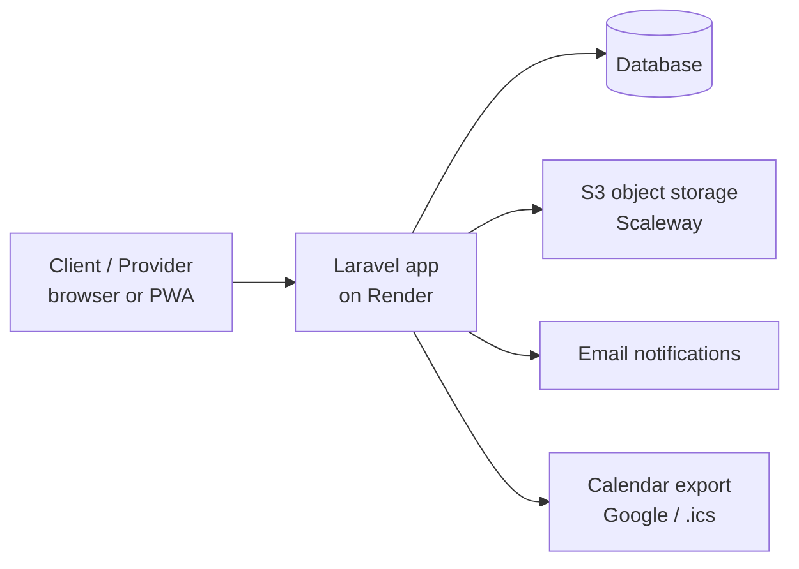

# Griot

**Booking platform for small service providers · Personal project · Live**

→ [Open the live app](https://griot-axbs.onrender.com/) · [Repository](https://github.com/franksToscani/griot)

## The problem

Many small service providers (hairdressers, braiders, beauticians, make-up artists, food vendors) take bookings through chats and phone calls. Griot gives each of them a showcase page and a simple way for clients to book.

## What it does

- Provider profiles with services, availability and photos.
- Client bookings with email notifications to both sides and a private link for the client.
- One-click export of confirmed bookings to **Google Calendar** and **Apple Calendar (.ics)**.
- Installable as a **Progressive Web App** on phone, tablet and desktop.
- Categories such as men's and women's haircuts, braids, locs, nails, make-up and food.

## Architecture and infrastructure

This diagram summarises the main components; it is not a full specification.

- **Hosting:** Render.
- **Media:** photos stored on S3-compatible object storage (Scaleway, Milan region) instead of the server disk.
- **Operations:** documented decisions on database backups, media risks and accessibility rules.

## How I work on it

- **Sprints and GitHub issues**, kept small and grouped by goal (launch, testing sessions, independent work).
- **Testing sessions with real providers** over video call; their feedback on UX and accessibility drives the next sprint.
- **AI-assisted development (Claude Code):** I define the requirements and architecture, review the code and run the tests with users.

## Status

Live in a private phase with invited providers; public launch planned after the testing sessions.
