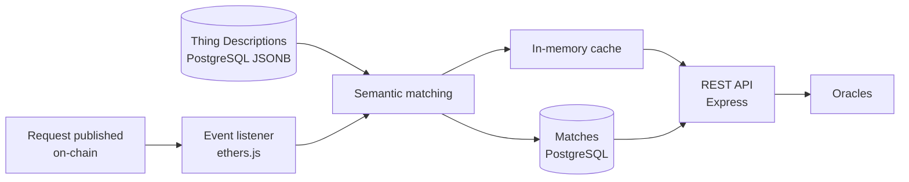

# Semantic Indexer for the Web of Things (ZONIA)

**Bachelor's thesis · University of Bologna · March 2026**

*Design and development of a semantic indexer for the Web of Things in blockchain-oriented architectures.*
Supervisor: Prof. Federico Montori · Co-supervisor: Dr. Lorenzo Gigli

→ [Repository](https://github.com/franksToscani/Indexer_ZONIA_node-WoT)

## Context

In IoT and Web of Things scenarios, applications need to find quickly which data producers match a request. In **ZONIA** (Zero-trust Oracle Network for IoT Applications), requests are published on-chain and the results must be available to off-chain components such as oracles.

## My contribution

- Designed and built an indexer that **listens to on-chain events**, selects compatible **Thing Descriptions** through semantic matching (based on metadata such as `@type`) and stores the matches.
- Exposed the results through a minimal **REST API** (`GET /data/:requestId`) queried by the oracles.
- Adopted a **two-level access strategy**: in-memory cache for fast local access and database persistence for sharing between processes and fallback.
- Guaranteed **idempotency** with a unique constraint on `(request_id, td_id)` and an index for fast retrieval.
- Wrote benchmark scripts for end-to-end and API latency.

## Workflow overview

This diagram summarises the main components; it is not a full specification.

## Stack

Node.js · Express · PostgreSQL (JSONB) · ethers.js · Hardhat (local EVM network)

## Evaluation

- Synthetic dataset of **10,000 Thing Descriptions**; load scenarios at **1, 10 and 30 requests/minute**.
- No API errors in the observed samples, API latency in the order of **hundreds of milliseconds**.
- Identified the saturation behaviour of end-to-end throughput and the main points to improve for scalability.
